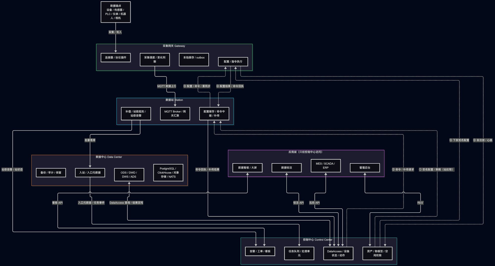
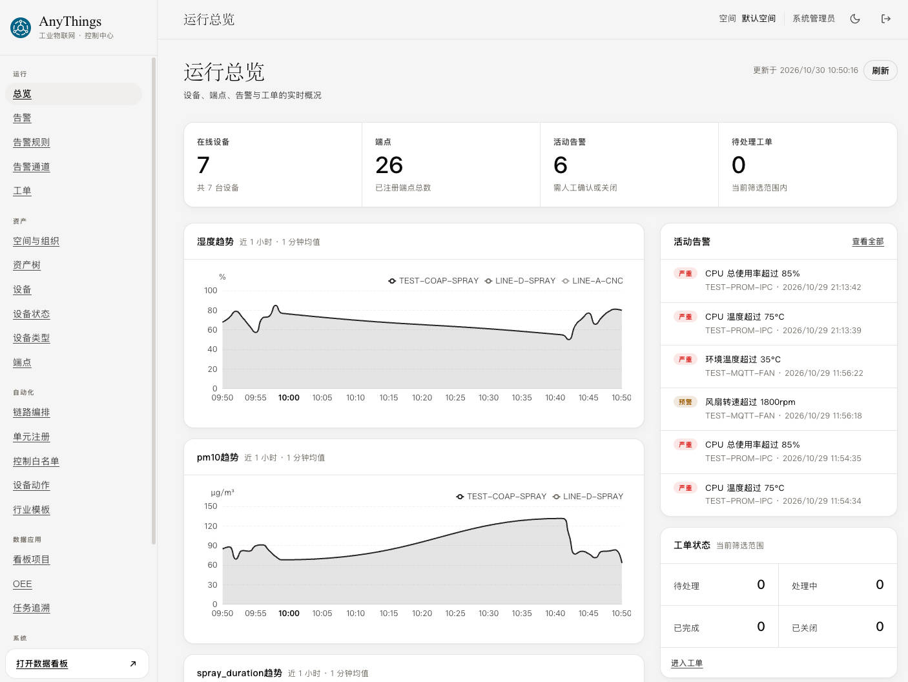
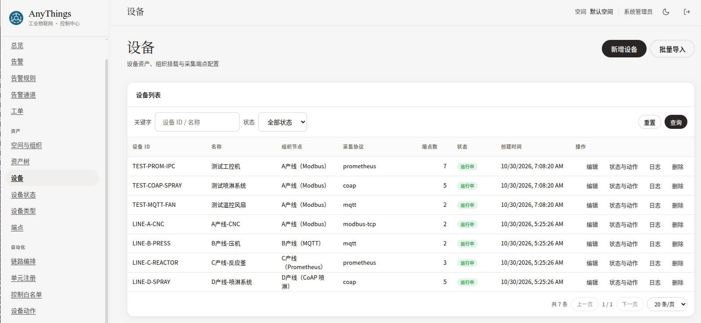
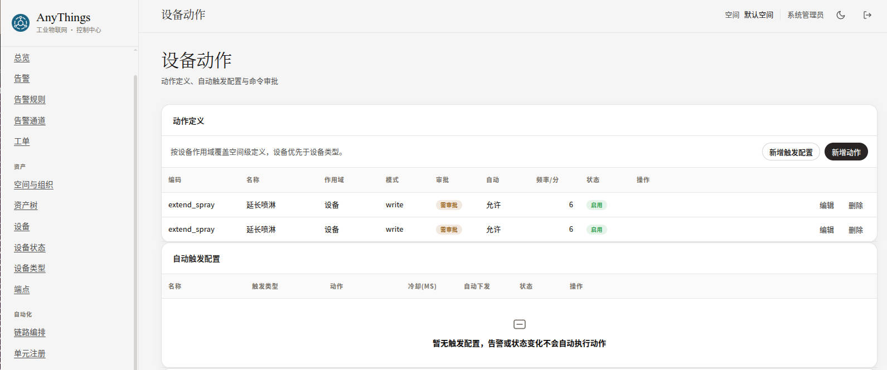
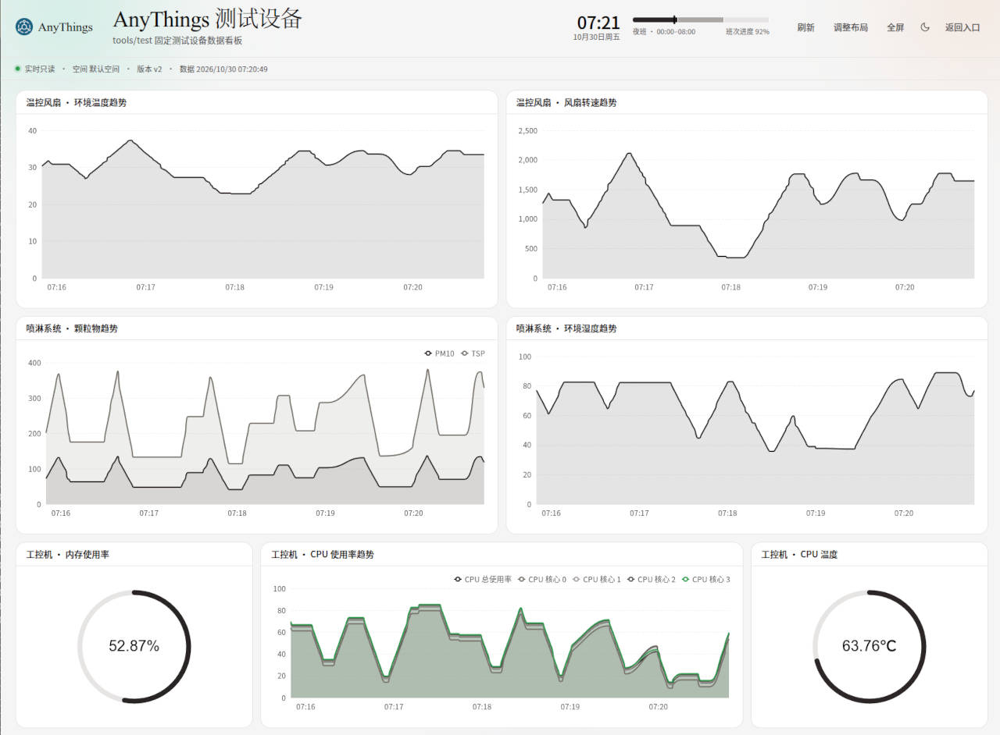
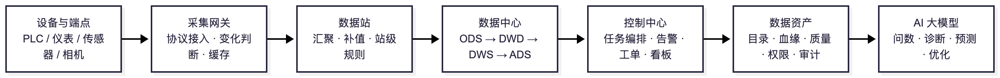
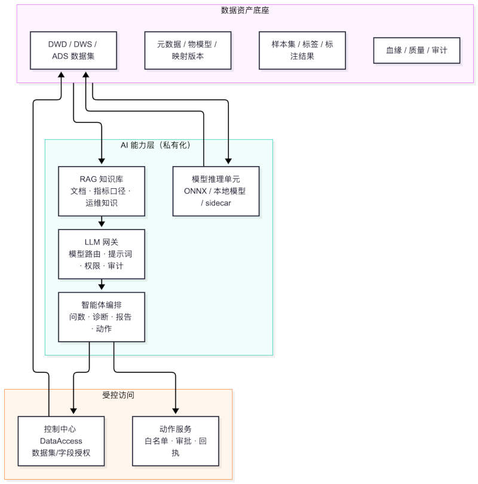

# AnyThings
高可用性、可扩展、可自定义的AIoT平台。

<p align="center">
  
</p>

## 产品定位

产品定位一句话：**在客户厂内私有化部署的工业物联网与数据资产平台**——数据不出厂、断网可运行、从设备接入一路走到数据资产，并为 AI 大模型应用提供高质量、可追溯的数据底座。

* 高可用性：采用多节点分布式设计，支持不同量级的设备数据采集和控制。
* 可扩展及灵活自定义：运维人员可以快速配置设备接入、自定义多个大屏输出形式。
* 数据自有: 所有系统可以私有化部署，数据资产完全自有。

## 项目组织

项目按**三个可独立部署的单元**组织，构建产物彼此独立：

| 部署单元 | 产物 |
|---|---|
| 采集网关 | `anythings-gateway` |
| 数据站 | `anythings-station` |
| 控制中心（含数据中心、WebUI） | `anythings-control-center`、`anythings-data-center`、三套前端静态资源 |

数据链路：数据端点 → 采集网关 → 数据站 → 数据中心 → 控制中心监控入口元数据 → 任务队列 → 处理单元 → 结果回写。


## 支持的数据采集协议

采集源 `sources[].protocol` 与端点 `endpoints[].protocol_identifier` 的协议名与网关驱动一一对应。下表仅列出已实现并通过单元测试的协议：

| 协议名 | 说明 | 读 | 写 |
|---|---|---|---|
| `modbus-tcp` | Modbus TCP 主站 | 保持/输入寄存器 | 单保持寄存器 |
| `modbus-rtu` | Modbus RTU 串口主站 | 保持/输入寄存器 | 单保持寄存器 |
| `mqtt` | 订阅现场主题并按 JSON 路径取值 | 是 | 否 |
| `dlt645` | DL/T645-1997/2007 电表（串口半双工） | 是 | 单数据项 |
| `cjt188` | CJ/T188-2004/2018 水气热表（串口半双工） | 是 | 是 |
| `s7` | Siemens S7comm over TCP | 是 | 是 |
| `melsec` | Mitsubishi MELSEC MC 3E（TCP/UDP） | 是 | 是 |
| `fins` | Omron FINS/TCP | 是 | 是 |
| `opc-ua` | OPC UA 客户端（`security_policy=none`） | 是 | 是 |
| `prometheus` | Prometheus `/metrics` 文本格式拉取（只读） | 是 | 否 |
| `coap` | CoAP 客户端（RFC 7252，明文 `coap://`） | 是 | 是 |
| `tcp` | 通用 TCP 请求-响应 | 是 | 是 |
| `udp` | 通用 UDP 请求-响应 | 是 | 是 |

`sql` 仍为预留协议，配置后会返回明确的“未启用”错误，不会静默跳过。

协议能力之外，还有三项工程化设计：
- **连接与协议分离**：串口/网络连接参数与协议标识解耦，同一连接可承载多个端点。
- **驱动隔离**：单个驱动 panic 或超时不拖垮主进程，单源故障不影响其他采集源。
- **私有协议扩展**：Lua 脚本只负责“报文 ↔ 标准点”，不参与调度、缓存、变化判断与上送；脚本受沙箱时限、内存上限与禁用库约束。


## 支持利用LLM对数据进行汇总分析 (TBD)

数据分析单元化，每个或每类设备自定义数据处理链路，增加不同的数据处理单元。

* 设备OEE数据、整体设备利用率分析及异常事件预测
* 故障的数据分析
* 数据趋势预测
* 实时故障处理决策辅助

## 系统设计

### 模块预览


### UI

* 登录


* 管理后台界面



* 设备管理界面



* 设备动作配置



* 看板界面



* 基础UI视频展示
(basic ui video)[https://www.bilibili.com/video/BV1bsxe65E7L]


---

## 全景：一条从设备到智能的主线

### 平台要解决的问题

工厂里的设备、传感器、PLC、仪表、机器人和人工检测点产生大量数据，但通常面临四个断点：

1. **接不进来**：协议碎片化，品牌与年代混杂，点位配置依赖人工。
2. **链路不可信**：断网丢数、重复上报、坏值混入、时间对不齐。
3. **数据不成资产**：数据散落在各系统，缺元数据、缺血缘、缺质量、缺权限与审计。
4. **智能用不上**：没有稳定、干净、可追溯的数据，AI 只能停留在演示。

AnyThings 用四个可独立部署的模块逐段解决：**采集网关 → 数据站 → 数据中心 → 控制中心**，并通过三个前端入口交付给不同角色。

### 四模块与三个入口

| 模块 | 角色 | 核心职责 |
|---|---|---|
| 采集网关 Gateway | 设备侧执行端 | 协议采集、变化判断、本地缓存与断点续传、指令执行、配置热更新 |
| 数据站 Station | 边缘汇聚与中继 | MQTT 汇聚、变化数据补值、站级规则与告警、缓存补传、命令中继、双机热备 |
| 数据中心 Data Center | 数据与元数据平面 | 批量落库、ODS/DWD/DWS/ADS 分层、对象存储、血缘、保留、备份、数据访问 |
| 控制中心 Control Center | 控制面主控 | 设备与端点台账、物模型、任务编排、处理单元、告警、工单、看板、标注、权限审计 |

| 前端入口 | 使用者 | 说明 |
|---|---|---|
| 管理后台 `/` | 设备/运维/实施工程师 | 内嵌于控制中心，完成配置、编排、运维与治理 |
| 数据看板 `/board/` | 生产/管理层、车间人员 | 独立登录与项目墙，面向车间大屏的只读展示 |
| 数据标注 `/label/` | 质检/标注人员 | 独立入口，完成样本标注与复核，为模型准备数据 |

### 价值链




| 阶段 | 解决的问题 | 关键能力 | 交付价值 |
|---|---|---|---|
| 设备管理 | 设备能不能接、点位准不准 | 多协议、台账、物模型、批量导入、网关纳管 | 把物理设备变成可计算的数据端点 |
| 数据链路 | 数据全不全、及不及时 | 补值、质量码、缓存补传、双机热备、幂等落库 | 数据可信、可对账、可追溯 |
| 数据加工 | 数据有没有业务含义 | 任务队列、处理单元、告警、工单、控制下发 | 从“有数据”到“有结论、有动作” |
| 数据资产 | 数据能不能复用、能不能治理 | 分层存储、元数据、血缘、质量、保留、备份、标注（规划） | 数据可查、可管、可审计、可复用 |
| AI 赋值 | 数据能不能产生智能 | 私有化模型、RAG、智能体、推理单元 | 降低使用门槛，放大数据资产价值 |

---

## 设备管理：把设备变成可计算的数据端点

**已实现**

设备管理不是一张设备清单，而是“**组织 → 设备 → 端点 → 协议 → 采集策略**”的完整建模过程。它决定了后续所有数据能否被正确解释。

### 空间、组织与资产树

- **多空间隔离**：按工厂/项目划分空间，设备、端点、看板、告警、工单均按空间隔离；跨空间资源统一不可见（返回 404）。
- **四级组织拓扑**：工厂 → 车间 → 产线 → 设备，对齐 ISA-95 层级，用于权限、告警通道继承与看板过滤。
- **资产树**：管理后台「资产」页按组织层级展示设备挂载关系，可下钻到设备端点，并单独列出未挂载设备，便于排查“有设备没归属”的台账问题。

### 设备台账与数据端点

| 对象 | 说明 |
|---|---|
| 设备 Device | 业务对象，含设备 ID、名称、组织归属、启用状态、自定义属性 JSON |
| 端点 Endpoint | 一次具体采集，含 `endpoint_id`、所属站点/网关、协议、连接参数、协议标识、采集周期、换算与单位 |
| 绑定关系 | 端点通过 `device_id + attribute_key` 绑定到业务设备属性，形成“业务设备.属性 = 值 + 单位 + 质量 + 时间” |

关键约束：

- `endpoint_id` 全局唯一且不可复用，建议 `站点.网关.协议.设备.属性`。
- 设备更换时保留历史端点并标记停用，保证历史数据仍可解释。
- 设备与端点均支持自定义属性 JSON，可承载资产编码、责任人、备注等业务信息。

### 物模型与行业模板

- **物模型元数据**：当前提供 `model_id + version + name + status` 的最小元数据，设备通过 `model_id` 引用，版本可发布/归档。
- **行业模板**：内置模板按行业组织，可一键应用设备、端点、处理链路与看板；应用过程幂等，已存在的对象跳过并返回统计，适合快速搭建同类产线。
- **设备级覆盖**：设备与端点均支持 `attributes` JSON，承载资产编码、责任人、工艺段等项目化信息。
- **规划**：属性/服务/事件三要素的完整物模型、模板批量实例化与单设备默认值覆盖、虚拟点位与公式计算。

### 批量导入与端点自动生成

管理后台「设备」页支持新增、编辑、删除设备并配置多个采集端点。批量导入接口 `POST /api/v1/devices/import` 支持：

- `[...]` 或 `{"devices":[...]}` 两种请求体；
- 每个端点至少提供 `station_id`、`source_id`、`protocol`、`attribute_key`；
- `endpoint_id` 留空时按 `站点.网关.协议.设备.属性` 自动生成；
- 按设备逐条执行，单条失败不中断其余设备，响应 `items` 给出每条结果与错误原因。

导入写入控制中心 `cc.device` / `cc.endpoint` 台账，保留完整 `connection` 与 `protocol_identifier`，供后续生成网关配置。

### 网关纳管：自注册与配置自动下发

网关不再依赖人工改本地文件：

1. 网关按 `control_center_base_url` 向控制中心注册，提交 `gateway_id`、`station_id`、协议源摘要、版本与端点规模，并周期心跳。
2. 控制中心按 `space_id + station_id + gateway_id` 从端点台账聚合采集源，生成全量 `sources[]` / `endpoints[]` 配置。
3. 配置计算 checksum 并做 ed25519 签名；内容未变化时沿用原版本，避免无效重启。
4. 网关校验 checksum、签名与 `gateway_id` 后原子写入本地 SQLite，并热更新采集任务。
5. 控制中心不可达时，网关继续使用最近一次已应用配置采集与上行，恢复后补拉新版本。

两种采集模式：

| 模式 | 行为 | 适用场景 |
|---|---|---|
| `managed`（默认） | 控制中心托管，自动采集台账内该网关全部端点 | 正常生产运行 |
| `standalone` | 不拉取中心配置，直接采集本地 `sources[]` / `endpoints[]` | 现场调试、断网首次部署、独立网关 |

控制中心提供网关查询接口，返回在线状态、端点规模与配置版本；心跳超过 90 秒展示为离线。生产环境必须配置持久签名密钥与独立服务令牌。

### 采集策略与边缘可靠性

| 能力 | 说明 |
|---|---|
| 采集周期 | 端点级配置，最小 100ms，常见 1s–60s |
| 变化判断 | `always` / `deadband` / `on_quality_change` / `disabled`；未变化时只上送时间与 `endpoint_id` |
| 工程换算 | `scale` / `offset` / `unit`，统一输出业务值 |
| 质量标记 | 全平台统一六值：`good` / `bad` / `timeout` / `overflow` / `manual` / `stale` |
| 本地缓存 | SQLite WAL 保存配置、端点状态与待发送队列，断电恢复不丢 |
| 断点续传 | 网络恢复后按序补发，超期数据进入死信，不静默丢弃 |
| 批量上送 | 按大小/时间/条数聚合，降低 MQTT 消息数 |
| 配置热更新 | 签名配置原子切换，非法配置拒绝应用并保留旧版本 |
| 资源保护 | 有界队列、内存上限、磁盘水位、采集限速，过载时背压而非 OOM |

### 设备状态与运行日志

设备状态由三态描述，而不是单一“在线/离线”：

- **运行状态**：运行 / 关机 / 告警 / 故障 / 离线 / 连接中
- **连接状态**：在线 / 离线 / 连接中
- **作业状态**：按设备类型定义

状态判定综合数据质量、离线超时、告警与人工覆盖，带去抖与优先级。每次状态迁移写入**同版本唯一的状态日志**，保留原因码、来源、证据与操作人，支持时间线追溯与最近变化查询。

**设备类型与状态档案**：按设备类型定义状态信号映射（数据点角色、离线超时、去抖时长、优先级）、默认动作与图标颜色；设备按类型继承，类型删除受引用设备保护。

**设备日志**：设备列表提供「日志」入口，统一聚合状态变化与动作执行记录，可按类型筛选。

### 设备动作与控制下发

写操作默认受控，是平台的安全底线。

| 环节 | 机制 |
|---|---|
| 动作定义 | 支持空间/设备类型/单设备三层作用域并逐层覆盖，含参数 Schema、目标写入、超时、频控、允许角色、审批要求与自动执行许可 |
| 审批 | 危险动作默认需审批，申请人不可自审；自动触发动作默认落待审批 |
| 签名下发 | 控制中心用 ed25519 签名命令，数据站领取落库并按租约下发，网关验签、校验许可与幂等后串行写入设备 |
| 回执 | 回执与结果先落库再中继；站侧断点续传、过期终止 |
| 兜底 | 控制中心保留命令状态机、审批人、错误码与结果，支持取消；失败不自动盲发 |
| 审计 | 操作者、审批、参数、回执、结果全留痕，可导出、不可篡改 |

自动触发支持**告警产生、告警恢复、设备状态变化**三类触发源，按来源过滤绑定参数并设置冷却时间，可选择仅建单或自动下发，结果全程可追溯。

---

## 数据链路：从现场到落库

**已实现**

### 数据站：边缘汇聚与站级闭环

| 能力 | 说明 |
|---|---|
| MQTT 汇聚 | 内嵌 Broker 接收网关上行，按 `gateway_id` 隔离主题与配额 |
| 变化数据补值 | 网关只报 `{time, endpoint_id}` 时，按该端点上一次值自动补齐，显著降低上行流量 |
| 补值缺失隔离 | 无基准值时不猜值，进入隔离并请求网关重同步 |
| 序列与去重 | 按 `boot_id + endpoint_id` 校验 `seq` 连续性，`msg_id` 去重，识别缺口与乱序 |
| 站级规则 | 阈值、持续时间、迟滞与去重窗口，支持静默与恢复；规则随配置快照热更新 |
| JS 脚本计算 | 规划：goja 沙箱执行，限制 CPU、内存与可调用 API，脚本异常不影响转发主链路 |
| 本地告警 | 在线时只上报控制中心统一投递；断网时本地发送并落库，恢复后补报并标记已本地投递，避免重复通知 |
| 缓存补传 | outbox + ACK 驱动，ACK 前不删除批次；恢复后按时间顺序补发并限速 |
| 命令中继 | 控制中心命令经站转发至网关，回传结果，按 `command_id` 幂等 |
| 双机热备 | 主备站共享网关归属，切换后网关重连备用站，队列由网关 outbox 兜底 |
| 离线许可 | 离线激活码按接入网关数、端点数与功能模块授权，过期仅降级不破坏数据 |

**站级与中心告警的职责边界**是设计重点：在线时站级规则命中只上报，由控制中心统一去重与投递；断网时站级自行发送并落库，恢复后补报且不重复投递。

### 幂等落库与分层写入

数据中心是数据进入平台的唯一入口：

- **批量接收**：`POST /api/v1/ingest/batches`，站级认证、schema/checksum/点数/大小/时间偏差校验，202 仅在持久化后返回。
- **幂等去重**：`station_id:batch_id` 去重；同键不同内容拒绝，重试不产生重复数据。
- **原始批次存档**：压缩报文写入对象存储，元数据库记录对象键、后端类型与校验和，可精确重放原始输入。
- **分层写入**：ODS 保留原始值、质量、时间、`mapping_version` 与原始报文；DWD 完成类型标准化、单位校验、坏值标记与去重；DWS 生成小时/天级特征；ADS 承载告警、指标与处理结果。
- **试采隔离**：端点 `ingest_mode=trial` 的影子数据写入独立 `dwd_point_trial`，不发布正式入口事件、不参与对账。
- **降级保护**：ClickHouse 不可用时保留原始批次并延迟发布事件，不丢数据、恢复后追平。

### 数据质量码

| 质量码 | 含义 | 是否坏值 |
|---|---|---|
| `good` | 正常采集值 | 否 |
| `bad` | 坏值（CRC 错误、驱动明确失败） | 是 |
| `timeout` | 采集/读取超时 | 是 |
| `overflow` | 值超出类型或量程 | 是 |
| `manual` | 人工修正值（可信） | 否 |
| `stale` | 超时未更新的陈旧值 | 是 |

网关、数据站、数据中心与控制中心使用同一枚举；DWD 的 `is_bad` 按此判定，聚合统计默认只计 `is_bad=0` 的样本。这是一条贯穿全平台的数据可信基线。

---

## 数据加工与业务闭环

**已实现**

数据落库之后，平台需要回答三个问题：**这数据意味着什么？要不要告警？要不要动作？**

### 入口元数据与任务队列

- 数据中心为每个落库点位生成入口元数据事件，包含 `event_id`、端点、设备、属性、时间、`data_type`、`payload_ref`。
- 控制中心消费入口事件，按 `event_id` 幂等，按 `data_type` / `endpoint_id` 前缀 / `device_id` / 组织节点匹配处理链路。
- 命中链路后为每笔数据生成全局唯一 `task_id` 与 `trace_id`，写入任务表并进入队列；未配置链路则仅完成落库。

### 处理单元与链路编排

**设计思想：能力原子化、流程配置化。** 每个处理单元只承担一类明确能力，业务链路由控制中心组合，单元本身不感知完整流程。三类单元的能力边界如下；当前内置单元覆盖标准化、结果回写、阈值告警、环境联动与 OEE 计算，其余能力按插件扩展：

| 类别 | 职责 | 能力范围 |
|---|---|---|
| 计算 | 数据计算与数据库读写 | 解析、单位换算、公式/脚本、聚合、特征计算、维表关联、结果落库；模型推理为规划能力 |
| 告警 | 按配置通道发送告警 | 阈值/持续时间判断、去重抑制、分级、通道选择、升级 |
| 控制 | 向设备发送远程指令 | 指令组装、白名单校验、下发、回执与超时处理 |

运行保障：

- **严格串行**：同一任务同一时刻仅一个单元执行，单元间只通过统一 Envelope 传递，可独立部署、替换与校验。
- **状态机**：`pending → running → success / failed / skipped / ignored / dead_letter`，支持重试与死信管理；按步重放为规划能力。
- **版本化**：链路与单元均版本化，支持灰度与回滚；在途任务继续使用旧版本。
- **幂等**：以 `task_id + step_no` 去重，结果按业务唯一键写入。
- **可观测**：任务级链路视图、单步耗时与成功率、队列积压、消费延迟。
- **隔离与防阻塞**：有界队列、并发上限、熔断、慢单元限流，单实例故障不影响全局。

**示例链路**：`解析 → 单位换算 → 特征计算 → 阈值告警 → 控制联锁 → 结果落库`。每步读取同一 `task_id` 的上下文，结果回写后传给下一单元。

### 告警中心

- **规则引擎**：数据站支持阈值、持续时间、迟滞、去重窗口与静默/恢复；控制中心提供按设备/组织/端点前缀/属性配置的阈值告警规则，可由系统托管链路执行。
- **分级与治理**：分级、去重、抑制、升级、确认、关闭、恢复通知。
- **通道管理**：站内消息、邮件、Webhook 已实现；短信网关、语音外呼、第三方协作工具按项目扩展。通道支持健康检查、失败重试与降级、发送记录审计。
- **层级继承**：按工厂/车间/产线/设备（工位）配置，下级未配置时逐级向上继承，默认工厂级，未配置层级不阻断投递。
- **证据链**：告警携带 `task_id` 与证据数据，可回溯到原始点位。
- **规划**：变化率、组合条件、班次过滤与定时任务规则。

### 工单与处理流水

告警可一键转工单，工单状态机闭环：待处理 → 处理中 → 已完成 → 已关闭。

- 创建、派单、接单、状态变更、处理措施、完成、关闭与重开，全部自动写入**仅追加**的处理流水。
- 流水记录操作人、操作时间、前后状态、备注与附件引用，不可修改。
- 支持按工单/设备/告警/时间检索，支撑运维检查、MTTA/MTTR 统计与审计追溯。

### 看板与大屏

- **看板项目**：在控制中心后台配置项目分组、主题、页面与图元、数据源绑定、发布版本与访问权限。
- **独立看板入口**：项目墙只列出已发布看板；登录态与后台隔离；大屏支持全屏、多页轮播、自动刷新、时钟与班次显示。
- **外观可配置**：深色/浅色大屏底色、标题副标题、刷新间隔 15–600 秒，不在前端写死。
- **现场适配**：支持拖动卡片、拉伸调整布局，调整仅保存在当前浏览器，不修改已发布版本；可一键重置。
- **只读取数**：运行时只经控制中心看板 API 取数，不直连数据中心。
- **设备状态组件**：设备状态汇总与状态树，支持按组织节点、设备类型过滤，展示状态计数、在线率与层级结构，支持多视图轮换。
- **OEE**：按设备/产线计算可用率、性能率、质量率与 OEE 指标，供管理层与车间大屏使用。

---

## 数据资产：把数据变成可治理、可复用的资产

**已实现（标注与部分治理能力规划中）**

数据资产不是“存了很多数据”，而是**知道有什么、从哪来、质量如何、谁能用、用了做什么、如何追溯**。AnyThings 用七层模型组织数据资产，并把治理动作嵌入日常运行。

### 七层数据资产模型

| 层级 | 内容 | 存储 | 当前状态 |
|---|---|---|---|
| 原始层 ODS | 原始点位、原始批次报文、原始图片/波形引用 | ClickHouse + 对象存储 | 已实现 |
| 清洗层 DWD | 清洗、对齐、坏值标记后的业务数据 | ClickHouse | 已实现 |
| 特征层 DWS | 小时/天级统计特征 | ClickHouse | 已实现（小时/天聚合） |
| 应用数据层 ADS | 告警、工单、指标、处理结果、OEE 等应用结果 | ClickHouse + PostgreSQL | 已实现（设备日指标、告警/工单/处理结果） |
| 资产层 | 端点注册、映射版本、设备、血缘、质量 | PostgreSQL | 已实现（目录/血缘/映射版本）；质量评分规划 |
| 模型层 | 模型文件、版本、评估报告、签名 | 对象存储 + PostgreSQL | 规划 |
| 审计层 | 操作、访问、检测留痕、升级记录 | PostgreSQL（可选 WORM） | 已实现（操作与访问审计） |

### 资产目录与元数据

- **端点注册表**：端点、协议标识、业务绑定、启停状态的权威登记；未登记端点隔离并告警。
- **映射版本**：端点解释规则（缩放、单位、类型）不可变、可对比、可回滚，历史数据按旧版本解释。
- **技术元数据**：数据类型注册、端点与映射版本、存储层归属、时间精度。
- **业务元数据**：设备、产线、资产编码、责任人、指标口径、班次、工艺段。
- **资产树**：按组织层级查看设备挂载与端点钻取，未挂载设备单独可见。

### 数据血缘

血缘回答“这个看板指标/告警/检测结果，最早来自哪个点位、经过哪些处理”。

- 链路：`ODS → DWD → DWS → ADS → 告警/工单/看板`。
- 每个处理结果保留 `task_id`、链路版本、处理单元版本与运行日志。
- 任意结果可回溯到原始点位与入口批次，保留处理链路与原始报文引用；按批次重放为规划能力。

### 数据质量

当前已落地：

- 全平台统一质量码与坏值标记，聚合统计默认过滤坏值；
- 数据站按 `boot_id + endpoint_id` 校验序列，`msg_id` 去重，识别重复与乱序；
- 网关 outbox + 数据站 ACK 的至少一次投递，断网恢复后按序补传；
- 数据站管理接口暴露网关状态、队列深度、告警与运行信息，便于定位链路断点。

规划中：

- 按 `endpoint_id` 水位的缺口检测与跨层对账（数据中心 → 控制中心 → 数据站 → 网关重同步）；
- 完整性、及时性、唯一性、越限率、坏值率的质量评分与报告；
- 按数据集与时间窗的质量看板与告警，以及质量 SLA 与责任人闭环。

### 存储、保留与备份

| 能力 | 说明 |
|---|---|
| 对象存储双后端 | MinIO/S3 兼容或本地文件系统，由系统配置选择；切换仅影响新写入对象，历史对象仍可按引用读取，支持在线迁移与连通性测试 |
| 保留策略 | 按层配置 ODS/DWD/DWS/ADS/备份保留天数，自动下发 ClickHouse TTL 并清理过期对象；试采数据固定保留 7 天，销毁留痕 |
| 备份与恢复 | PostgreSQL、ClickHouse、对象存储定时备份、校验与恢复演练；数据中心提供 `-backup`、`-verify-backup`、`-migrate-objects` 子命令 |
| Parquet 导出 | 按数据集/时间窗导出到对象存储数据湖（规划）；当前提供北向 CSV 导出任务 |
| 容量治理 | 通过分层 TTL、保留策略与备份策略控制存储增长；磁盘/表/分区/对象水位监控与容量预测为规划能力 |
| 多空间隔离 | 集团多工厂本地部署时逻辑隔离，跨空间数据不可见 |

**RPO/RTO 目标**：RPO ≤ 15 分钟，RTO ≤ 4 小时（按方案配置）。

### 数据服务：只经控制中心

应用层不直连网关、数据站或数据中心。控制中心提供统一数据访问：

- **DataAccess**：单元与应用按数据集、字段授权读写；写操作幂等。
- **gRPC over Unix Domain Socket**：控制中心与数据中心同机双进程，内部取数默认走 gRPC，`ReadSeries` 服务端流式返回，规避大结果集消息体上限；HTTP `:8090` 保留健康检查与运维接口。
- **查询能力**：最新值、历史序列、聚合与降采样、指标查询；断网可用。
- **北向接口**：提供受控 REST 查询与 CSV 导出任务（可重试、可下载、可审计），供厂内 MES/SCADA/ERP 集成；MQTT/Webhook/Kafka 等集成方式按项目扩展。

### 标注：把样本也变成资产

**规划（独立前端入口与任务列表界面已搭建）**

数据标注是连接“数据资产”与“模型能力”的桥。

- **独立标注入口** `/label/`，标注人员使用厂内账号登录，与管理后台、看板登录态隔离。
- **样本集**：图片、波形、时序片段；样本对象存对象存储，元数据与任务存控制中心。
- **标签体系**：标签定义、层级与互斥规则。
- **任务流程**：任务分配、进度管理、标注-复核双角色、状态流转（待开始/标注中/复核中/已完成/已归档）。
- **产物回存**：标注结果落数据中心 ADS 层，与样本、任务、标注人、复核人绑定，支持导出训练集与版本化。
- **可追溯**：标注与样本可追溯、可重放导出，为模型训练与评估提供合法数据来源。

### 安全、权限与合规

| 维度 | 能力 |
|---|---|
| 身份与权限 | 多用户、RBAC 角色/权限、空间授权；API Token 绑定角色与空间，可过期可吊销，不存明文 |
| 数据隔离 | 空间级隔离 + 行级过滤；跨空间统一 404 |
| 审计 | 管理操作、数据访问、导出、备份、销毁、配置变更全量审计，可导出 |
| 导出管控 | 导出审批与水印（规划）；当前支持导出记录审计 |
| 网络与部署 | 私有化默认、零公网依赖、厂内 DMZ/白名单端口；远程只读诊断默认关闭、授权开启、全审计、可一键断连（规划） |
| 许可与升级 | 控制中心、数据站、网关离线许可激活；四模块离线升级包签名校验、灰度与回滚、升级前备份 |
| 数据归属 | 原始数据、特征、处理结果与审计日志全部本地落库；模型与检测能力落地后同样本地存储，默认不上传 |

### 资产价值闭环

| 原始输入 | 加工过程 | 资产形态 | 使用方 |
|---|---|---|---|
| PLC 寄存器、仪表读数、MQTT 消息 | 采集 → 补值 → 清洗 → 特征 | DWD 点位序列、DWS 特征 | 看板、告警、OEE |
| 告警与工单 | 规则判定 → 去重 → 派单 → 处理 | ADS 告警、工单流水 | 运维、管理层 |
| 图片、波形、时序片段 | 标注 → 复核 → 导出 | 样本集、标签、标注结果（规划） | 模型训练与评估 |
| 处理链路运行记录 | 任务追踪 → 血缘 → 复盘 | 任务日志、血缘图 | 实施、审计、算法 |

**一个端到端例子**：Modbus 温度点 `slave=1, fc=03, addr=40001, int16, ×0.1, °C` → 端点 `SZ01.ST01.GW03.MODBUS.CNC01.spindle_temp` → 业务 `设备 CNC-01 / 属性 spindle_temperature / 单位 °C` → 数据中心按 `device_id=CNC-01, attribute_key=spindle_temperature, value=63.5, unit=°C, quality=good` 落库，原始报文与 `mapping_version` 同步保留 → 看板展示趋势、规则触发告警、工单闭环、血缘可回溯。

---

## AI 大模型赋值：让数据资产产生智能

### 为什么必须从数据资产出发

大模型在工业场景的瓶颈通常不是模型本身，而是：

- 不知道“设备/点位/指标”是什么（缺元数据）；
- 不知道数据从哪来、可不可信（缺血缘与质量）；
- 不知道谁能看、谁能改（缺权限与审计）；
- 不知道现场停机/断网的约束（缺私有化与离线能力）。

AnyThings 的设备台账、物模型、映射版本、血缘、质量码、标注与审计，正好构成大模型可用的**上下文底座**。AI 不是另起一套系统，而是数据资产的“消费层”。

### 三阶段路线

| 阶段 | 目标 | 关键交付 | 前置条件 |
|---|---|---|---|
| 数据准备 | 让数据“可训练、可评估” | 样本集与标签体系、训练集版本化、特征回填、质量过滤 | 标注应用、DWS/ADS、对象存储 |
| 模型与推理 | 让模型“进得来、跑得稳” | 本地模型仓库、模型签名与版本、站级推理 sidecar、推理处理单元、灰度与回滚 | 模型层、处理单元框架、许可体系 |
| 大模型智能体 | 让大模型“懂业务、能办事” | 私有化 LLM 网关、RAG 知识库、自然语言问数、告警解释、报告生成、运维助手 | 元数据/血缘/质量、DataAccess、审计 |

### 能力蓝图

| 能力 | 用户价值 | 输入 | 依赖 | 边界 |
|---|---|---|---|---|
| 自然语言问数 | “昨天 A 线 CNC-01 主轴温度最高多少？” | 设备/端点元数据、历史序列、指标口径 | DataAccess、语义层、LLM | 只读查询；生成 SQL/查询计划需校验与限权 |
| 告警解释 | 把告警翻译成“发生了什么、可能为什么、先查什么” | 告警证据、相邻点位、历史同类告警、工单记录 | 血缘、告警中心、知识库 | 输出为建议，不替代人工确认 |
| 根因推荐 | 关联多变量与工况，给出候选根因排序 | DWS 特征、工况标签、维修记录 | 特征工程、模型、标注 | 需可解释证据链，避免“黑箱结论” |
| 运维知识助手 | 现场问答：协议怎么配、点位为什么坏、升级怎么做 | 产品文档、配置、日志、审计 | RAG、权限过滤 | 只回答有依据的内容，引用来源 |
| 自动报告 | 班报/日报/周报：产量、OEE、告警、能耗、异常 | ADS 指标、工单、班次 | 指标层、模板、LLM | 数字来自系统，不让模型编造 |
| 预测性维护 | 健康度评分、剩余寿命、异常趋势 | 振动/温度/电流/声学特征 | 特征层、模型仓库、推理单元 | 按场景验证，不承诺零样本高精度 |
| 视觉缺陷检测 | 分类/分割/定位，绑定批次、工单、图片 | 图片样本、标注、检测模型 | 标注应用、模型仓库、站级推理 | 检测记录绑定模型版本与阈值 |
| 工艺参数优化 | 参数与质量相关性、班次对比、优化建议 | 工艺参数、质量结果、班次 | 数据资产、因果/统计方法 | 建议优先；闭环写控制需审批与白名单 |
| 智能体联动动作 | “发现异常 → 建单/通知/下发” | 告警、工单、动作定义 | 处理单元、动作服务、审批 | 写操作默认审批，全程审计 |

### AI技术架构



关键设计：

- **私有化优先**：模型文件本地仓库，离线导入/导出、签名校验、版本固定；默认不外传数据。
- **RAG 而非“喂全库”**：只把与问题相关的元数据、指标口径、文档片段与聚合结果送入上下文，降低幻觉与泄露风险。
- **工具化访问**：大模型不直连数据库，只通过受控工具调用 DataAccess/动作服务，权限与行级隔离沿用现有体系。
- **可解释证据链**：回答附带引用的点位、时间窗、指标口径、血缘路径与质量状态。
- **人在回路**：写控制、工艺参数调整、模型上线均需审批；模型输出默认是建议。
- **全量审计**：谁问了什么、模型引用了什么、生成了什么、是否被执行，全部留痕。
- **离线可运行**：LLM 网关、向量库、推理服务均可厂内部署；断外网不影响采集、告警与看板。

### 落地前提与里程碑

| 里程碑 | 内容 | 判定标准 |
|---|---|---|
| M1 数据可用 | 元数据、血缘、质量、标注闭环 | 任一问数可定位到点位与批次；样本集可导出版本 |
| M2 模型可管 | 模型仓库、签名、版本、灰度、回滚 | 模型可离线导入、固定版本推理、失败可回滚 |
| M3 推理可嵌 | 推理处理单元、站级 sidecar | 推理结果回写 ADS，链路可追踪、可重放 |
| M4 问数可信 | 自然语言问数 + 语义层 + 权限 | 回答带证据、越权拒绝、口径一致 |
| M5 智能体可用 | 告警解释、报告、运维助手 | 有引用来源、可审计、人工可纠正 |
| M5+ 闭环优化 | 预测性维护、视觉检测、工艺优化 | 按场景验收召回率/误报率，不承诺泛化 |

---

## 部署与运行形态

**已实现**

| 形态 | 适用对象 | 说明 |
|---|---|---|
| 单机一体机 | 中小企业/单车间 | 控制中心+数据中心合并部署；网关与数据站按规模独立部署；离线许可 |
| 厂内集群 | 中大型工厂 | 控制中心+数据中心本地高可用；数据站按车间部署；网关就近部署 |
| 数据站+控制中心两级 | 多车间/多产线 | 边缘本地闭环，中心统一管理；数据仍不出厂 |
| 集团本地联邦 | 多工厂集团 | 各厂本地落库，集团仅汇总指标/模型（规划） |

运行特征：

- **构建产物独立**：`anythings-gateway`、`anythings-station`、`anythings-control-center`、`anythings-data-center` 与三套前端静态资源。
- **进程角色可拆**：控制中心支持 `--role=all|api|engine|worker|scheduler` 拆分部署。
- **离线升级**：发布包带 `version.json`、`install.sh`、`run.sh` 与 systemd 单元；在线升级由控制中心登记并分发签名离线包，校验清单签名、SHA-256 与大小后原子替换，失败回滚。
- **可观测**：健康检查、结构化日志、任务链路视图、队列水位、采集成功率、协议错误；日志按 5 MiB 轮转保留 7 个文件。
- **断网能力**：断外网 ≥ 7 天稳定运行（设计目标 ≥ 30 天，按缓存与许可策略）。

---

## 能力边界与演进

### 当前能力盘点

| 领域 | 已实现 | 规划/部分 |
|---|---|---|
| 设备接入 | 14 种协议、Lua 扩展、批量导入、网关自注册、托管配置、变化判断、缓存续传 | SQL 协议、更多行业协议按项目 |
| 设备管理 | 台账、端点、物模型元数据、行业模板、资产树、设备状态、状态日志、动作审批、命令回执 | 完整物模型三要素、模板实例化、虚拟点位 |
| 数据链路 | 补值、质量码、站级规则、告警边界、网关 outbox 补传、双机热备、幂等落库、试采隔离 | 跨层缺口检测与对账补传 |
| 数据加工 | 任务队列、处理单元、链路编排、版本灰度、死信管理、告警、工单、看板、OEE | 任务重放、更丰富的内置单元 |
| 数据资产 | ODS/DWD/DWS/ADS、端点注册、映射版本、血缘、保留、备份、对象存储双后端、CSV 导出 | 质量评分报告、资产目录增强、Parquet 导出、标注产物、入表支撑报表 |
| AI | — | 模型仓库、推理单元、LLM 网关、问数、诊断、报告、预测、视觉检测 |
| 安全合规 | RBAC、空间隔离、审计、许可、离线升级 | 远程只读诊断、等保认证目标、导出审批与水印、信创适配清单 |

### 明确不做

- 不以公有云多租户 SaaS 为主形态；
- 不默认上传客户数据；
- 不在未授权情况下远程写控制。

### 演进原则

1. **私有化与离线优先**：任何新能力必须能在断外网的厂内环境完成采集、告警、展示与审计。
2. **链路可诊断**：从端点到看板的每一段都可观测、可对账、可复盘。
3. **现场优先**：车间大屏、触摸一体机与长时间值守是默认场景。
4. **能力原子化、配置化**：协议、处理单元、看板图元以插件/配置组合，不为单项目写死。
5. **写操作默认受控**：白名单、审批、回执、审计缺一不可。
6. **AI 以证据说话**：数字来自系统，结论附引用，模型输出默认是建议。

---

## 附录：术语表

| 术语 | 定义 |
|---|---|
| 数据端点 Data Endpoint | 网关接入的单个数据来源，如设备、传感器、PLC、仪表、相机、人工检测点 |
| 入口元数据 Ingress Metadata | 数据中心记录的数据到达信息与日志，含端点、时间、类型与落库位置 |
| 处理单元 Processing Unit | 原子化数据处理能力，分计算、告警、控制三类，按统一协议串行编排 |
| 处理链路 Chain | 按数据类型/端点匹配的一组有序处理步骤，版本化、可灰度、可回滚 |
| 映射版本 Mapping Version | 端点解释规则（缩放、单位、类型）的不可变版本 |
| 质量码 Quality | 全平台统一六值枚举，用于坏值判定与统计过滤 |
| 数据血缘 Lineage | 从原始点位到指标、告警、检测结果的全链路追溯关系 |
| 补值 Backfill | 网关未变化时只报时间与端点，由数据站按上一次值补齐 |
| 试采 Trial | 端点影子运行，数据隔离存储，不发布正式事件 |

## 附录：功能与模块对照

| 功能域 | 主要承载模块 | 管理入口 |
|---|---|---|
| 设备/端点/物模型 | 控制中心 | 管理后台 → 设备、端点、模板 |
| 网关纳管与配置 | 控制中心 + 网关 | 管理后台 → 设备/网关状态 |
| 采集与边缘缓存 | 网关 | 网关本地 + 运维日志 |
| 补值/站级规则/补传 | 数据站 | 数据站管理页 |
| 落库/分层/血缘/备份 | 数据中心 | 数据中心运维接口 + 管理后台 |
| 任务编排/处理单元 | 控制中心 | 管理后台 → 任务链路、处理单元、任务追踪 |
| 告警/工单/控制 | 控制中心 | 管理后台 → 告警、告警规则、通道、工单、控制下发 |
| 看板/大屏/OEE | 控制中心 + 看板应用 | 管理后台 → 看板项目；`/board/` |
| 标注 | 控制中心 + 标注应用（规划） | `/label/` |
| 权限/审计/配置/升级 | 控制中心 | 管理后台 → IAM、空间、审计、系统配置、升级 |
| AI 能力（规划） | 控制中心 + 数据中心 + 数据站 | 待定义 |

---

## 部署

### Linux系统中安装

```bash
cd dist/release/gateway && sudo ./install.sh
cd dist/release/station && sudo ./install.sh
cd dist/release/center  && sudo ./install.sh   # 控制中心与数据中心一起安装
```

安装脚本默认安装到 `/opt/anythings/<module>`，配置写入 `/etc/anythings/`，
数据写入 `/var/lib/anythings/<module>`，并安装 systemd 单元。已有配置默认保留，
需要覆盖时使用 `--force-config`。

安装期依赖检查：

- `center`：检查 `PostgreSQL`、`ClickHouse`、`NATS`；对象存储为 `s3`/`minio` 时检查 MinIO，
  任一依赖不可达直接报错退出。
- `gateway`：检查数据站 MQTT Broker；数据站尚未安装时可 `--skip-deps`。
- `station`：使用内嵌 SQLite 与内嵌 MQTT Broker，无外部数据库/消息队列依赖。

### Docker

```bash
cp deploy/compose/.env.example deploy/compose/.env
# 编辑 .env：替换所有 CHANGE_ME 口令，按需配置 SERVICE_TOKEN 等
docker compose -f deploy/compose/docker-compose.yml up -d --build

# 现场网关可选启动（默认使用 edge profile）
docker compose -f deploy/compose/docker-compose.yml --profile edge up -d gateway
```

编排包含：`postgres`、`clickhouse`、`nats`、`minio`、`station`、`center`，网关按 `edge` profile 选启；网关容器挂载 `docker/config/gateway.json`，与镜像内默认配置同源。

编排中所有常驻服务统一以 `${PUID:-1000}:${PGID:-1000}` 运行，默认 `1000:1000`，与宿主数据目录/命名卷的文件属主保持一致。`postgres-init`、`clickhouse-init`、`nats-init`、`minio-init` 是一次性容器：仅在命名卷属主与 `PUID:PGID` 不一致时以 root 修正属主，属主正确时直接跳过，常驻服务本身不以 root 运行。

访问入口：

- 管理后台：`http://<host>:8081/`（默认管理员 `admin` / `.env` 中的 `BOOTSTRAP_PASSWORD`）
- 看板入口：`http://<host>:8081/board/`（独立登录；登录后选择已发布看板进入大屏）
- 标注：`http://<host>:8081/label/`
- 数据中心：`http://<host>:8090`（建议仅内网访问）
- 数据站 MQTT：`<host>:1883`，健康检查 `<host>:18081`
